<!-- terminal:start -->

<!-- terminal:end -->

  

  
  
  
  

  
  
  
  
  

  
  

  

  <picture>
    <source media="(prefers-color-scheme: dark)" srcset="https://raw.githubusercontent.com/Dhirenderchoudhary/Dhirenderchoudhary/output/github-contribution-grid-snake-dark.svg">
    
  </picture>

